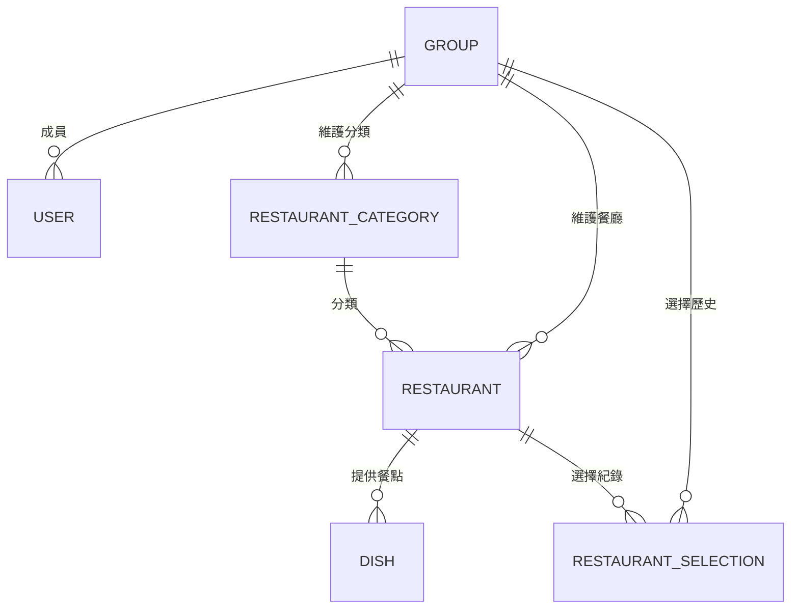

# MoguMogu Pick — Backend

團體餐廳管理與抽選系統的後端服務，讓朋友、同事或家人可以共同維護餐廳清單、管理餐點與分類，並透過隨機抽選解決每天「要吃什麼？」的問題。

除了餐廳抽選，系統也提供群組成員管理、餐廳選擇歷史與附近餐廳搜尋等功能，透過 REST API 提供前端整合使用。


## 專案功能

| 功能模組 | 功能說明 |
| --- | --- |
| 會員驗證 | 會員註冊、登入與 JWT 身分驗證 |
| 群組管理 | 建立群組、修改群組名稱、新增成員、退出群組及移轉管理權 |
| 餐廳管理 | 新增、查詢、修改與刪除餐廳，支援關鍵字、分類篩選及分頁 |
| 餐廳分類 | 依群組維護餐廳分類及顯示順序 |
| 餐點管理 | 維護餐廳的餐點名稱、價格及顯示順序 |
| 隨機抽選 | 依群組及分類抽選餐廳，支援抽籤池重置及確認選擇 |
| 選擇歷史 | 新增、查詢與刪除群組餐廳選擇紀錄 |
| 附近餐廳 | 依經緯度及搜尋半徑查詢附近餐廳 |

## 技術與設計

### 技術棧

| 技術 | 版本 | 用途 |
| --- | --- | --- |
| Java | 25 | 後端開發語言 |
| Spring Boot | 4.1.3 | 應用程式框架與自動設定 |
| Spring MVC | Spring Boot 管理 | REST API 與 HTTP 請求處理 |
| Spring Security / OAuth2 Resource Server | Spring Boot 管理 | JWT Bearer Token 驗證與授權 |
| Spring Data JPA | Spring Boot 管理 | ORM、資料存取、分頁與排序 |
| Bean Validation | Spring Boot 管理 | 請求欄位與參數驗證 |
| MySQL / MySQL Connector/J | 驅動由 Spring Boot 管理 | 關聯式資料庫與 JDBC 連線 |
| H2 Database | 2.4.240 | 輕量型關聯式資料庫 |
| Flyway / Flyway MySQL | Spring Boot 管理 | 資料庫 Schema 版本管理與遷移 |
| Spring RestClient | Spring Boot 管理 | 呼叫外部 HTTP API |
| springdoc-openapi / Swagger UI | 3.2.1 | API 文件與互動式測試 |
| Apache POI (OOXML) | 6.0.0 | Excel（`.xlsx`）檔案處理 |
| Spring Boot Actuator | Spring Boot 管理 | 應用程式健康檢查及監控支援 |
| Lombok | Spring Boot 管理 | 減少重複性程式碼 |
| Spring Boot DevTools | Spring Boot 管理 | 開發期間自動重新啟動等輔助功能 |
| Maven | — | 相依套件管理、編譯、測試及建置 |
| Spring Boot Test Starters | Spring Boot 管理 | JPA、Validation 與 Web MVC 測試支援 |

> 版本依 `pom.xml` 所宣告的設定列出；未獨立指定版本的相依套件由 Spring Boot 管理。上述用途說明為相依套件提供的能力，不代表所有功能均已完成或啟用。

### API 設計特色

- **群組化資料管理**：餐廳、餐廳分類及選擇歷史均具有群組識別資訊。
- **角色設計**：區分系統管理員、群組管理員及一般使用者。
- **統一分頁格式**：清單回傳 `data`、`page`、`limit` 與 `total`，並支援分頁及排序參數。
- **請求與回應分離**：使用 `CreateRequest`、`UpdateRequest`、`Response` 等 DTO 表達不同操作所需的資料。
- **輸入限制**：API 規格定義必填欄位、字串長度、價格、識別碼與經緯度範圍等限制。
- **HTTP 語意**：以 `GET` 查詢、`POST` 新增或執行操作、`PATCH` 部分更新、`DELETE` 刪除，並依 API 回傳對應狀態碼。

## 使用者角色

| 角色 | 說明 |
| --- | --- |
| `SYSTEM_ADMIN` | 系統管理員，可使用規格標示為系統管理員的全域清單 API |
| `GROUP_ADMIN` | 群組管理員，負責群組資訊、成員及管理權移轉 |
| `USER` | 一般使用者，為群組餐廳管理與抽選功能的使用者 |

> 上表為角色用途概述；各 API 的實際存取權限以後端授權規則為準。

## 本機開發與啟動

### 環境需求

- JDK 25
- Apache Maven（若專案包含 Maven Wrapper，亦可使用 Wrapper）
- 資料庫：H2 或 MySQL，依實際 Spring Profile 與資料來源設定選用

### 設定與執行

啟動前，請依專案的 `application.yml`、各環境設定檔及環境變數設定資料庫連線與 JWT 簽章密鑰。MySQL 環境須先準備可連線的資料庫；Flyway 是否執行遷移依該環境設定而定。請勿將正式資料庫密碼或 JWT 密鑰提交至 Git。

在含有 `pom.xml` 的專案根目錄執行：

```bash
mvn spring-boot:run
```

若專案有 Maven Wrapper，Windows PowerShell 可改用：

```powershell
.\mvnw.cmd spring-boot:run
```

啟動成功後可前往 Swagger UI：<http://localhost:8080/swagger-ui/index.html>（預設路徑）。

### 測試與建置

```bash
# 執行測試
mvn test

# 編譯、測試並打包
mvn clean package

# 啟動打包後的 Spring Boot 應用程式
java -jar target/mogumogu-1.0.1-SNAPSHOT.jar
```

`pom.xml` 已配置 Spring Boot Maven Plugin、Maven Compiler Plugin 與 Lombok Annotation Processor，並引入 Data JPA、Validation、Web MVC 的測試相依套件。實際測試覆蓋範圍以專案測試程式為準。

## API 使用方式

| 項目 | 內容 |
| --- | --- |
| API 名稱 | MoguMogu Pick API |
| API 版本 | `v1.0.1` |
| Maven 專案版本 | `1.0.1-SNAPSHOT` |
| Maven 座標 | `com.romi:mogumogu` |
| 本機 Base URL | `http://localhost:8080` |
| 文件規格 | OpenAPI `3.1.0` |
| 驗證方式 | HTTP Bearer JWT |
| API 數量 | 32 個操作（24 條路徑） |

本機服務啟動後，若採用 springdoc-openapi 的預設路徑，可透過下列網址查看與測試 API：

- Swagger UI：<http://localhost:8080/swagger-ui/index.html>
- OpenAPI JSON：<http://localhost:8080/v3/api-docs>

### 登入與驗證

以電子郵件及密碼登入：

```http
POST /auth/login
Content-Type: application/json
```

```json
{
  "email": "amy@test.com",
  "password": "123"
}
```

登入成功後，回應包含 JWT `token`、使用者 ID、群組 ID、角色及會員基本資料。呼叫需驗證的 API 時，將取得的 Token 放入 HTTP Header：

```http
Authorization: Bearer <token>
```

也可透過 Swagger UI 的 **Authorize** 功能設定 Token。上述帳密取自 API 文件的登入範例，僅供本機測試示意。

### 分頁、排序與篩選

以群組餐廳清單為例：

```http
GET /restaurants/group/1?page=0&size=10&sort=displayOrderId,asc&categoryId=2
```

| 參數 | 說明 |
| --- | --- |
| `page` | 頁碼，從 `0` 開始 |
| `size` | 每頁筆數；多數清單預設為 20，群組餐廳清單預設為 10 |
| `sort` | 排序條件，格式為 `欄位名稱,asc` 或 `欄位名稱,desc` |
| `keyword` | 餐廳關鍵字搜尋（餐廳清單 API） |
| `categoryId` | 餐廳分類篩選（餐廳清單 API） |

分頁回應格式（以下為無資料的示意回應）：

```json
{
  "data": [],
  "page": 0,
  "limit": 10,
  "total": 0
}
```

> 請求參數為 `size`，回應欄位為 `limit`，依目前 API 規格命名。

### 餐廳抽選

抽選功能提供三種操作：

| 操作 | API |
| --- | --- |
| 隨機抽選餐廳 | `POST /restaurants/random` |
| 確認選擇餐廳 | `POST /restaurants/random/choose/{id}` |
| 重置抽籤池 | `POST /restaurants/random/clear` |

抽選時可傳入 `categoryId` 與 `randomPool`，回應包含抽中的餐廳、總筆數與剩餘筆數。確認選擇餐廳後，依 API 定義重置抽籤池。系統另提供餐廳選擇紀錄的新增與查詢 API。

### 附近餐廳搜尋

```http
GET /restaurants/map?lat=25.0478&lon=121.517&radius=500
```

| 參數 | 預設值 | 有效範圍 |
| --- | --- | --- |
| `lat` | 25.0478 | -90 ～ 90 |
| `lon` | 121.517 | -180 ～ 180 |
| `radius` | 50 | 1 ～ 3000 |

回應包含搜尋中心的經緯度、餐廳總筆數，以及餐廳名稱、地址、緯度與經度。

## API 一覽

下列清單依功能模組分類，詳細請求欄位及回應結構可參考 Swagger。

### 會員驗證（Auth）

| Method | Endpoint | Description | Status |
| --- | --- | --- | --- |
| `POST` | `/auth/register` | 註冊 | `201` |
| `POST` | `/auth/login` | 登入 | `200` |

### 群組管理（Groups）

| Method | Endpoint | Description | Status |
| --- | --- | --- | --- |
| `GET` | `/groups` | 取得所有群組(系統管理員) | `200` |
| `POST` | `/groups` | 新增群組 | `200` |
| `GET` | `/groups/{groupId}/members` | 取得群組成員清單 | `200` |
| `POST` | `/groups/{groupId}/members` | 新增群組成員（管理員） | `201` |
| `POST` | `/groups/{groupAdminUserId}/transfer-admin/{transferUserId}` | 移轉群組管理權（管理員） | `204` |
| `POST` | `/groups/leave/{userId}` | 退出群組 | `204` |
| `GET` | `/groups/{groupId}` | 依群組ID取得群組資料 | `200` |
| `PATCH` | `/groups/{groupId}` | 修改群組（管理員） | `200` |

### 餐廳分類（Restaurant Categories）

| Method | Endpoint | Description | Status |
| --- | --- | --- | --- |
| `POST` | `/restaurant-categories/group` | 新增目前使用者群組的分類 | `201` |
| `DELETE` | `/restaurant-categories/{id}` | 刪除餐廳分類 | `204` |
| `PATCH` | `/restaurant-categories/{id}` | 修改餐廳分類 | `200` |
| `GET` | `/restaurant-categories` | 取得所有餐廳分類(系統管理員) | `200` |
| `GET` | `/restaurant-categories/group/{groupId}` | 取得指定群組的餐廳分類清單 | `200` |

### 餐廳管理（Restaurants）

| Method | Endpoint | Description | Status |
| --- | --- | --- | --- |
| `GET` | `/restaurants` | 取得餐廳清單(系統管理員) | `200` |
| `POST` | `/restaurants` | 新增餐廳 | `201` |
| `GET` | `/restaurants/{id}` | 依餐廳ID取得餐廳資料 | `200` |
| `DELETE` | `/restaurants/{id}` | 刪除餐廳 | `204` |
| `PATCH` | `/restaurants/{id}` | 修改餐廳 | `200` |
| `GET` | `/restaurants/map` | 搜尋附近餐廳 | `200` |
| `GET` | `/restaurants/group/{id}` | 取得自己所屬群組的餐廳清單 | `200` |

### 餐點管理（Dishes）

| Method | Endpoint | Description | Status |
| --- | --- | --- | --- |
| `POST` | `/dishes` | 新增餐點 | `201` |
| `DELETE` | `/dishes/{id}` | 刪除餐點 | `204` |
| `PATCH` | `/dishes/{id}` | 修改餐點 | `200` |
| `GET` | `/dishes/restaurant/{restaurantId}` | 取得指定餐廳的餐點清單 | `200` |

### 餐廳抽選（Restaurant Random）

| Method | Endpoint | Description | Status |
| --- | --- | --- | --- |
| `POST` | `/restaurants/random` | 抽取自己所屬群組的一間餐廳 | `200` |
| `POST` | `/restaurants/random/clear` | 重置抽籤池 | `204` |
| `POST` | `/restaurants/random/choose/{id}` | 確認選擇餐廳並重置抽籤池 | `200` |

### 選擇歷史（Restaurant Selections）

| Method | Endpoint | Description | Status |
| --- | --- | --- | --- |
| `POST` | `/restaurant-selections/group` | 新增目前使用者群組的餐廳選擇紀錄 | `201` |
| `GET` | `/restaurant-selections/group/{groupId}` | 取得指定群組的餐廳選擇歷史 | `200` |
| `DELETE` | `/restaurant-selections/{id}` | 刪除單筆餐廳選擇紀錄 | `204` |

## HTTP 狀態碼

| 狀態碼 | 說明 |
| --- | --- |
| `200 OK` | 查詢、更新或操作成功 |
| `201 Created` | 資源建立成功 |
| `204 No Content` | 操作成功，無回應內容 |

## 主要資料模型

| 模型 | 主要資料 |
| --- | --- |
| User | 會員資訊、角色、群組識別碼 |
| Group | 群組名稱、建立與更新時間 |
| Restaurant Category | 群組識別碼、分類名稱、顯示順序 |
| Restaurant | 群組及分類識別碼、名稱、地址、備註、圖片、選擇次數與最後選擇時間 |
| Dish | 餐廳識別碼、餐點名稱、價格、顯示順序 |
| Restaurant Selection | 群組識別碼、餐廳識別碼、選擇時間 |

以下為依 API 欄位整理的概念關聯圖，並非實際資料庫 ERD：



---

MoguMogu Pick Backend · REST API `v1.0.1`
